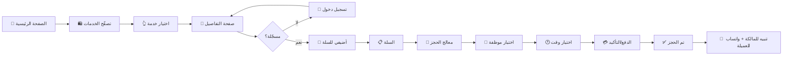
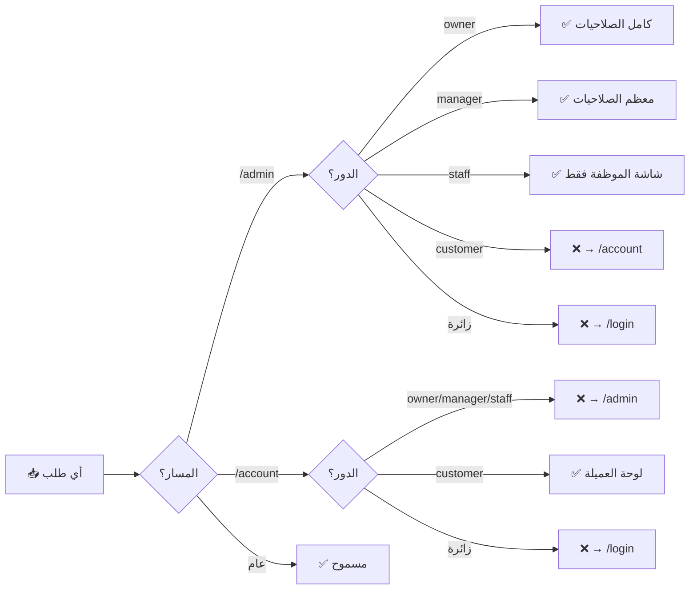

# 🏗️ هيكل المشروع — Be First Lady

> **بي فيرست ليدي** · صالون وسبا نسائي فاخر في المدينة المنوّرة
> نظام إداري وموقع ويب + تطبيق جوال (PWA)

---

## 📐 نظرة عامة · Mermaid Diagram

```mermaid
graph TD
    A[👤 المستخدم] --> B{نوع الحساب}
    B -->|عميلة| C[/account<br/>لوحة العميلة]
    B -->|مالكة| D[/admin<br/>لوحة المالكة]
    B -->|موظفة| E[/admin<br/>لوحة الموظفة]
    B -->|زائرة| F[/<br/>الصفحة الرئيسية]

    F --> G[/services<br/>قائمة الخدمات]
    G --> H[/services/:id<br/>تفاصيل الخدمة]
    H --> I[/cart<br/>السلة]
    I --> J[/booking<br/>معالج الحجز]
    J --> K[(Supabase<br/>قاعدة البيانات)]

    C --> K
    D --> K
    E --> K

    K --> L[WhatsApp API]
    K --> M[Email · Resend]
    K --> N[Push · OneSignal]

    style A fill:#c9a96e,color:#fff
    style K fill:#2a1c10,color:#fff
    style D fill:#c9a96e,color:#fff
    style E fill:#dfb589,color:#fff
    style C fill:#f0d4b2,color:#2a1c10
```

---

## 🗂️ هيكل الملفات

```
befirstlady-v2/
│
├── 📄 package.json              → تعريفات الحزم (Next 15.5.4 · React 19)
├── 📄 next.config.ts            → إعدادات Next.js
├── 📄 tailwind.config.ts        → ثيم Tailwind (ألوان ذهبية · خطوط عربية)
├── 📄 tsconfig.json             → إعدادات TypeScript
├── 📄 .env.example              → مثال لمتغيّرات البيئة
├── 📄 README.md                 → دليل المشروع
│
├── 📂 docs/                      ← التوثيق
│   ├── ARCHITECTURE.md          → هذا الملف
│   ├── INTEGRATIONS_SETUP.md    → إعداد WhatsApp · Email · Push
│   ├── LAUNCH_GUIDE.md          → دليل الإطلاق للإنتاج
│   └── TEST_ACCOUNTS.md         → حسابات تجريبية للاختبار
│
├── 📂 public/                    ← الملفات العامة
│   ├── manifest.webmanifest     → PWA (تحميل كتطبيق)
│   ├── fonts/                   → الخطوط
│   ├── icons/                   → أيقونات التطبيق (16→512px)
│   ├── images/
│   │   ├── gallery/             → معرض الأعمال
│   │   ├── icons/               → أيقونات الفئات
│   │   ├── story/               → صور قصّة المركز
│   │   └── services/            → صور الخدمات
│   └── videos/
│
├── 📂 scripts/                   ← سكريبتات مساعدة
│   ├── create-test-users.ts     → إنشاء حسابات تجريبية
│   └── generate_pwa_icons.py    → توليد أيقونات PWA
│
├── 📂 supabase/                  ← قاعدة البيانات
│   ├── migrations/              → ترحيلات SQL (schema + RLS)
│   └── seed/                    → بيانات أوليّة + ربط الصور
│
└── 📂 src/                       ← الكود المصدري
    ├── 📄 middleware.ts         → حماية المسارات + توجيه الأدوار
    │
    ├── 📂 app/                   ← Next.js App Router (كل صفحة = مجلّد)
    │   ├── layout.tsx           → الهيكل العام (الخطوط · Toaster · PWA)
    │   ├── page.tsx             → الصفحة الرئيسية (ديسكتوب + موبايل)
    │   ├── globals.css          → الأنماط العامة + أنيميشن البتلات 🌸
    │   ├── manifest.ts          → PWA manifest ديناميكي
    │   │
    │   ├── 🔐 login/            → تسجيل الدخول
    │   ├── 🔐 signup/           → إنشاء حساب
    │   ├── 🔐 forgot-password/  → استعادة كلمة المرور
    │   ├── 🔐 reset-password/   → إعادة تعيين
    │   │
    │   ├── 🛍️  services/        → قائمة الخدمات
    │   │   └── [id]/           → تفاصيل خدمة واحدة
    │   ├── 🛒 cart/             → السلة
    │   ├── 📅 booking/          → معالج الحجز
    │   ├── 🎁 gift-cards/       → بطاقات الهدايا
    │   │
    │   ├── 👤 account/          ← لوحة العميلة
    │   │   ├── page.tsx         → الملخّص + حلقة الولاء
    │   │   ├── bookings/        → حجوزاتي
    │   │   ├── profile/         → ملفّي
    │   │   ├── attendance/      → الحضور (للموظفات)
    │   │   ├── leaves/          → الإجازات
    │   │   └── referral/        → الإحالة
    │   │
    │   ├── 👑 admin/            ← لوحة المالكة والموظفات
    │   │   ├── page.tsx         → ديشبورد ذكي (إيرادات · حجوزات اليوم)
    │   │   ├── layout.tsx       → AdminShell (الشريط الجانبي + الموبايل)
    │   │   ├── bookings/        → إدارة الحجوزات (كالندر + جدول)
    │   │   ├── customers/       → العميلات
    │   │   ├── staff/           → الموظفات
    │   │   ├── services/        → الخدمات
    │   │   ├── packages/        → الباقات
    │   │   ├── gallery/         → معرض الأعمال
    │   │   ├── reviews/         → التقييمات
    │   │   ├── coupons/         → الكوبونات
    │   │   ├── gift-cards/      → بطاقات الهدايا
    │   │   ├── inventory/       → المخزون
    │   │   ├── payroll/         → الرواتب
    │   │   ├── attendance/      → الحضور
    │   │   ├── leaves/          → طلبات الإجازة
    │   │   ├── reports/         → التقارير والتحليلات
    │   │   ├── push/            → إشعارات ماركتينغ
    │   │   ├── reminders/       → التذكيرات التلقائية
    │   │   ├── settings/        → الإعدادات
    │   │   └── users/           → إدارة الصلاحيات
    │   │
    │   ├── 🧾 invite/[bookingNumber]/  → دعوة لحجز (رابط مشاركة)
    │   ├── ⭐ review/[bookingNumber]/   → ترك تقييم بعد الحجز
    │   ├── ⚖️  legal/           → السياسات (الخصوصية · الاستبدال · الشروط)
    │   ├── 📴 offline/           → صفحة الـoffline للـPWA
    │   │
    │   └── 🔌 api/               ← Backend (Next.js API Routes)
    │       ├── auth/            → logout · callback (Supabase SSR)
    │       ├── account/         → bookings · profile
    │       ├── bookings/        → إنشاء حجز
    │       ├── availability/    → توفّر المواعيد
    │       ├── staff-available/ → توفّر الموظفات
    │       ├── reviews/         → تقييمات
    │       ├── coupons/         → تحقّق من الكوبون
    │       ├── gift-cards/      → بطاقات
    │       ├── inventory/       → المخزون
    │       ├── payroll/         → الرواتب
    │       ├── leaves/          → الإجازات
    │       ├── attendance/      → تسجيل حضور (checkin/checkout)
    │       ├── push/send/       → إرسال إشعارات
    │       └── admin/           → عمليات إدارية (محمية)
    │
    ├── 📂 components/            ← مكوّنات قابلة لإعادة الاستخدام
    │   ├── 📂 account/          → بطاقات العميلة (حجز · حضور · إحالة)
    │   ├── 📂 admin/            → مكوّنات الأدمن (14 ملف)
    │   │   ├── AdminShell       → الهيكل العام (sidebar + bottom nav)
    │   │   ├── StaffDashboard   → ديشبورد الموظفة الفاخر
    │   │   ├── BookingsCalendar → كالندر الحجوزات
    │   │   ├── NotificationBell → جرس تنبيهات + تذكير 3 دقائق 🔔
    │   │   ├── GlobalSearch     → بحث عالمي بالموظفات والعميلات
    │   │   └── ...
    │   ├── 📂 booking/          → معالج الحجز (BookingWizard)
    │   ├── 📂 cart/             → السلة (CartFab + CartClient)
    │   ├── 📂 layout/           → Header + Footer
    │   ├── 📂 mobile/           → تجربة الموبايل (الناتيف)
    │   │   ├── MobileHomeApp    → الصفحة الرئيسية للموبايل (كاروسيلات)
    │   │   ├── MobileBottomNav  → شريط التنقّل السفلي (5 تابات)
    │   │   └── AppSplash        → شاشة الترحيب للـPWA
    │   ├── 📂 sections/         → أقسام الصفحة الرئيسية (ديسكتوب)
    │   │   ├── HeroSection      → القسم الأعلى (بطل)
    │   │   ├── ServicesSection  → قائمة الخدمات بالبتلات 🌸
    │   │   ├── GallerySection   → معرض الأعمال
    │   │   ├── ReviewsSection   → تقييمات العميلات
    │   │   └── ...
    │   ├── 📂 services/         → صفحات الخدمات
    │   │   ├── ServicesListClient → القائمة مع الفلاتر
    │   │   └── ServiceDetailClient → تفاصيل الخدمة + تقييمات
    │   └── 📂 ui/               → واجهات أساسية
    │       ├── Petals.tsx       → 🌸 بتلات متساقطة (أنيميشن CSS)
    │       ├── LoaderScreen     → شاشة التحميل
    │       ├── FloatingButtons  → واتساب + تواصل سريع
    │       └── PWARegister      → تسجيل Service Worker
    │
    ├── 📂 hooks/                ← React Hooks مخصّصة
    │   └── useCart.ts           → السلة (localStorage + custom events)
    │
    ├── 📂 lib/                   ← مكتبات مساعدة
    │   ├── utils.ts             → formatPrice · formatDuration · waLink
    │   ├── geo.ts               → حساب المسافات (للـcheckin)
    │   ├── zatca.ts             → ضريبة القيمة المضافة (الفوترة)
    │   ├── 📂 supabase/
    │   │   ├── client.ts        → Supabase للـclient (المتصفح)
    │   │   └── server.ts        → Supabase للـserver (SSR + cookies)
    │   ├── 📂 integrations/     ← تكاملات خارجية
    │   │   ├── whatsapp.ts      → إرسال رسائل واتساب
    │   │   ├── email.ts         → إرسال إيميلات (Resend)
    │   │   ├── push-sender.ts   → إشعارات Push (OneSignal)
    │   │   └── moyasar.ts       → بوّابة الدفع
    │   └── 📂 mobile/
    │       ├── haptics.ts       → اهتزاز الجوال (Vibration API)
    │       └── geolocation.ts   → الموقع (للـcheckin)
    │
    └── 📂 types/
        └── database.ts          → أنواع TypeScript لجداول Supabase
```

---

## 🔀 تدفّق العميلة (User Flow)



---

## 🎨 نظام التصميم (Design System)

| العنصر | القيمة |
|--------|--------|
| **اللون الأساسي** | `#c9a96e` ذهبي فاخر (gold-light) |
| **اللون العميق** | `#7d613b` ذهبي داكن (gold-deep) |
| **لون النص** | `#2a1c10` بنّي داكن (ink) |
| **الخلفية** | `#fbf7ef` كريم فاتح (cream-50) |
| **الخط العربي الفاخر** | Amiri (العناوين) |
| **الخط العربي الحديث** | Cairo (الفقرات) |
| **الخط اللاتيني الفاخر** | Cormorant Garamond |
| **الخط اللاتيني العناوين** | Cinzel |

---

## 🔐 الأدوار والصلاحيات (Middleware)



---

## 🌸 الخدمات الذكيّة الخاصّة

1. **🌸 بتلات متساقطة** — أنيميشن CSS على بطاقات الخدمات (يعمل تلقائي على الموبايل · على hover في الديسكتوب)
2. **🔔 إشعارات صوتيّة + تذكير 3 دقائق** — جرس تنبيه عند حجز جديد في `NotificationBell`
3. **📱 PWA كامل** — يُحمَّل كتطبيق على iOS و Android
4. **🛒 سلّة بـ localStorage** — تبقى بعد إعادة التحميل، مع custom events للتزامن
5. **📍 حضور بالموقع الجغرافي** — للموظفات (checkin/checkout)
6. **🌙 إجبار الوضع الفاتح** — الموقع فاخر، ما يتأثّر بالدارك مود للنظام

---

## 📦 الحزم الرئيسية

| الحزمة | الاستخدام |
|--------|-----------|
| `next@15.5.4` | إطار العمل |
| `react@19` | المكتبة الأساسية |
| `@supabase/ssr` | المصادقة + قاعدة البيانات |
| `tailwindcss@3.4` | التنسيقات |
| `framer-motion@11` | الأنيميشن |
| `lucide-react` | الأيقونات |
| `date-fns@4` | التواريخ |
| `recharts` | الرسوم البيانيّة |
| `sonner` | التنبيهات (Toasts) |
| `react-hook-form + zod` | النماذج والتحقق |

---

**آخر تحديث:** 2026-10-18
**المالكة:** Abdullrahman Fahad Shaheen · Shaheen Design
